# Architecture — Hexagonal (Ports & Adapters)

## Overview

The **Heartbeat Radar Sensor** project follows **Hexagonal Architecture** (also known as *Ports & Adapters*).
In embedded systems development, firmware code is frequently tangled with vendor-specific SDKs (e.g., `<Arduino.h>`, ESP-IDF APIs, driver libraries). This makes automated testing without hardware almost impossible, leads to tight coupling, and prevents replacing sensors or displays without rewriting application logic.

By isolating the **Core Domain** behind abstract **Ports (Interfaces)**, we achieve:
1. **Host-Side Testing (TDD):** Run Catch2 unit tests in Docker on x86 desktop within milliseconds.
2. **Hardware Agnosticism:** Swap sensors (e.g., HLK-LD2450 to RD-03D or multi-sensor RCWL-0516) or displays (ST7789 to ILI9341 or SSD1306) simply by implementing a new adapter.
3. **Clean Code & SOLID:** Strong adherence to Single Responsibility, Open/Closed, Liskov Substitution, Interface Segregation, and Dependency Inversion.

---

## Architectural Diagram

```mermaid
flowchart TD
    subgraph Core["Core Domain (Pure C++17, zero hardware deps)"]
        RadarEngine["RadarEngine\n- Target tracking & aging\n- Range classification\n- Sweep management"]
        SignalProcessor["SignalProcessor\n- Threshold filtering\n- Coordinate scaling\n- Noise dampening"]
        Target["Target\n- Coordinates (X, Y)\n- Speed & Distance\n- Contact state"]
    end

    subgraph Ports["Ports (Abstract C++ Interfaces)"]
        ISensor["ISensor\n+ scan() : std::vector&lt;TargetData&gt;\n+ configure(sensitivity) : bool"]
        IDisplay["IDisplay\n+ drawRadar(targets) : void\n+ drawSweep(angle) : void\n+ drawAlert(zone) : void"]
        ITimer["ITimer\n+ millis() : uint32_t\n+ delay(ms) : void"]
        IBuzzer["IBuzzer\n+ beep(freq, duration) : void"]
    end

    subgraph Adapters["Adapters (Hardware & Platform Specific)"]
        LD2450["LD2450Adapter\nimplements ISensor\n(Hardware UART2)"]
        ST7789["ST7789Adapter\nimplements IDisplay\n(SPI / TFT_eSPI)"]
        ESP32Timer["ESP32TimerAdapter\nimplements ITimer\n(FreeRTOS / Arduino millis)"]
    end

    subgraph TestAdapters["Test / Simulation Adapters"]
        MockSensor["MockSensor\nimplements ISensor\n(Deterministic simulation)"]
        MockDisplay["MockDisplay\nimplements IDisplay\n(Buffer verification)"]
        MockTimer["MockTimer\nimplements ITimer\n(Manual time advance)"]
    end

    subgraph FutureAdapters["Future Sensor Adapters"]
        RCWL["RCWL0516TriangulationAdapter\nimplements ISensor"]
        RD03D["RD03DAdapter\nimplements ISensor"]
    end

    RadarEngine --> ISensor
    RadarEngine --> IDisplay
    RadarEngine --> ITimer
    RadarEngine --> IBuzzer
    RadarEngine --> SignalProcessor
    RadarEngine --> Target

    LD2450 --> ISensor
    ST7789 --> IDisplay
    ESP32Timer --> ITimer

    MockSensor --> ISensor
    MockDisplay --> IDisplay
    MockTimer --> ITimer

    RCWL -.-> ISensor
    RD03D -.-> ISensor
```



---

## Layers

### 1. Core Domain (`src/core/`)
- Pure C++17 logic with **zero** platform headers (`<Arduino.h>`, `esp_*.h`).
- Only standard library headers permitted (`<vector>`, `<cstdint>`, `<memory>`, `<algorithm>`).
- **`RadarEngine`**: Central orchestrator. Updates targets, manages radar sweep angle, evaluates detection zones (Near / Mid / Far).
- **`SignalProcessor`**: Validates raw sensor inputs, removes noise, and maps coordinate grids.
- **`Target`**: Data structure and lifecycle methods for tracked contacts.

### 2. Ports & Composite Patterns (`src/ports/`)
Abstract base classes defining pure virtual contracts. When multi-module operation is required, **Composite Adapters** implement the port contract:

```mermaid
flowchart LR
    subgraph MultiSensorFusion["Multi-Sensor Fusion (CompositeSensor)"]
        ISensor["ISensor Contract"]
        CompSens["CompositeSensor\n(implements ISensor)"]
        S1["Sensor 1 (Front LD2450)"]
        S2["Sensor 2 (Rear RD-03D)"]
        ISensor <|.. CompSens
        CompSens --> S1
        CompSens --> S2
    end

    subgraph MultiDisplayBroadcast["Multi-Display Broadcaster (CompositeDisplay)"]
        IDisplay["IDisplay Contract"]
        CompDisp["CompositeDisplay\n(implements IDisplay)"]
        D1["TFT Display (ST7789)"]
        D2["PC Serial Telemetry (USB JSON)"]
        D3["Wireless Phone Sync (BLE)"]
        IDisplay <|.. CompDisp
        CompDisp --> D1
        CompDisp --> D2
        CompDisp --> D3
    end
```

- **`CompositeSensor` (Fusion):** Aggregates $N$ radar sensors into a unified coordinate list with spatial de-duplication.
- **`CompositeDisplay` (Broadcaster):** Fans out radar draw calls to $M$ simultaneous output sinks (e.g. Physical TFT + USB Serial Telemetry + BLE).

### 3. Adapters (`src/adapters/`)
- Hardware-specific implementations that interact with ESP32 peripherals.
- **`LD2450Adapter`** (`ld2450_adapter.cpp` / `ld2450_protocol.cpp`): Parses 256000 baud UART binary frames into `TargetData`.
- **`ST7789Adapter`**: Uses `TFT_eSPI` to draw tactical radar UI on 240x320 SPI display.
- **`ESP32TimerAdapter`**: Implements timing via native ESP32 clock functions.

---

## Data Flow

```mermaid
sequenceDiagram
    autonumber
    participant App as Main Loop (main.cpp)
    participant Sensor as LD2450Adapter (ISensor)
    participant Core as RadarEngine
    participant Display as ST7789Adapter (IDisplay)

    App->>Sensor: scan()
    Sensor-->>App: std::vector&lt;TargetData&gt;
    App->>Core: update(targets, current_time)
    Core->>Core: filter & update contact tracks
    Core->>Core: advance sweep angle
    Core-->>App: getVisibleTargets()
    App->>Display: drawSweep(angle)
    App->>Display: drawRadar(visible_targets)
```

---

## Dependency Injection in `main.cpp`

Hardware adapters are instantiated in `main.cpp` and injected into `RadarEngine` via constructor:

```cpp
// Composition Root (main.cpp)
LD2450Adapter sensor(Serial2);
ST7789Adapter display;
ESP32TimerAdapter timer;

RadarEngine engine(sensor, display, timer);

void setup() {
    engine.init();
}

void loop() {
    engine.tick();
}
```

In test suites (`test_native/`), `MockSensor`, `MockDisplay`, and `MockTimer` are injected instead!
