# Architecture — Hexagonal (Ports & Adapters)

## Overview

Hexagonal architecture (ports & adapters).
Problem: firmware tangled with vendor SDKs (`<Arduino.h>`, ESP-IDF, driver libs) → no hardware-free tests, tight coupling, sensor/display swap needs app rewrite.
Fix: core domain behind abstract ports.

Result:
1. **Host tests (TDD):** Catch2 in Docker on x86, milliseconds.
2. **Hardware swap:** new sensor (HLK-LD2450 → RD-03D, RCWL-0516 array) or display (ST7789 → ILI9341, SSD1306) = new adapter only.
3. **SOLID:** SRP, OCP, LSP, ISP, DIP.

---

## Diagram

```mermaid
flowchart TD
    subgraph Core["Core Domain (pure C++17, no hardware deps)"]
        RadarEngine["RadarEngine\n- scan → transform → evaluate\n- sweep angle\n- buzzer pacing"]
        Evaluator["DistanceThreatEvaluator\nimplements IThreatEvaluator"]
        Transformer["CoordinateTransformer\n- mounting + attitude rotation"]
        Attitude["AttitudeEstimator\n- IMU → Orientation"]
        Parser["LD2450Parser\n- binary frame decode"]
        TargetData["TargetData\n- x_mm, y_mm, speed_cms\n- zone(danger_m, caution_m)"]
    end

    subgraph Ports["Ports (abstract C++ interfaces)"]
        ISensor["ISensor\n+ init() : bool\n+ scan() : std::vector&lt;TargetData&gt;\n+ specs() : SensorSpecs\n+ is_connected() : bool"]
        IDisplay["IDisplay\n+ init() / clear() / flush()\n+ draw_sweep(angle_deg)\n+ draw_radar(targets)\n+ draw_alert(threat)\n+ draw_attitude(orientation, imu)"]
        ITimer["ITimer\n+ millis() : uint32_t\n+ delay_ms(ms)"]
        IBuzzer["IBuzzer\n+ beep(freq_hz, duration_ms)\n+ stop()"]
        IImu["IImu\n+ init() / is_connected()\n+ read_imu(out) : bool"]
        IThreat["IThreatEvaluator\n+ evaluate(targets) : ThreatAssessment"]
    end

    subgraph Adapters["Adapters (hardware / platform)"]
        LD2450["LD2450Adapter\nimplements ISensor\n(UART2)"]
        Serial["SerialDisplayAdapter\nimplements IDisplay\n(JSON over Serial)"]
        Wifi["WifiDisplayAdapter\nimplements IDisplay\n(JSON over TCP)"]
        ST7789["ST7789Adapter\nimplements IDisplay\n(SPI / TFT_eSPI, stub)"]
        ESP32Timer["ESP32TimerAdapter\nimplements ITimer"]
        Buzzer["ESP32BuzzerAdapter\nimplements IBuzzer\n(PWM)"]
        MPU["MPU6050Adapter\nimplements IImu\n(I2C)"]
    end

    subgraph TestAdapters["Test mocks (test_native/mocks/)"]
        MockSensor["MockSensor"]
        MockDisplay["MockDisplay"]
        MockTimer["MockTimer"]
        MockBuzzer["MockBuzzer"]
        MockImu["MockImu"]
        MockEval["MockThreatEvaluator"]
    end

    subgraph FutureAdapters["Planned sensor adapters"]
        RCWL["RCWL0516TriangulationAdapter\nimplements ISensor"]
        RD03D["RD03DAdapter\nimplements ISensor"]
    end

    RadarEngine --> ISensor
    RadarEngine --> IDisplay
    RadarEngine --> ITimer
    RadarEngine --> IBuzzer
    RadarEngine --> IImu
    RadarEngine --> IThreat
    RadarEngine --> Transformer
    RadarEngine --> Attitude
    Evaluator --> IThreat

    LD2450 --> ISensor
    LD2450 --> Parser
    Serial --> IDisplay
    Wifi --> IDisplay
    ST7789 --> IDisplay
    ESP32Timer --> ITimer
    Buzzer --> IBuzzer
    MPU --> IImu

    MockSensor --> ISensor
    MockDisplay --> IDisplay
    MockTimer --> ITimer
    MockBuzzer --> IBuzzer
    MockImu --> IImu
    MockEval --> IThreat

    RCWL -.-> ISensor
    RD03D -.-> ISensor
```



---

## Layers

### 1. Core Domain (`src/core/`)
- Pure C++17. No platform headers (`<Arduino.h>`, `esp_*.h`).
- Standard library only (`<vector>`, `<cstdint>`, `<memory>`, `<algorithm>`, `<cmath>`).
- **`RadarEngine`**: orchestrator. `update()`: scan sensor, read IMU, transform coords, evaluate threat, advance sweep, draw, pace buzzer.
- **`DistanceThreatEvaluator`**: targets → `ThreatAssessment`; zones `Safe` / `Caution` / `Danger` from `danger_distance_m`, `caution_distance_m`.
- **`CoordinateTransformer`**: mounting yaw + attitude compensation into device forward frame.
- **`AttitudeEstimator`**: IMU samples → `Orientation`.
- **`LD2450Parser`**: LD2450 binary frame decode (sign-magnitude ints).
- **`TargetData`**, **`SensorSpecs`**, **`ThreatAssessment`**, **`ImuData`**: value types.

### 2. Ports & Composite Pattern (`src/ports/`)
Abstract base classes, pure virtual contracts.
Multi-module operation → composite adapter implementing same port.
**Status: planned.** `CompositeSensor` / `CompositeDisplay` not implemented; `build.sh` and `main.cpp` reject multi-sensor/multi-display builds. Design: `docs/backlog/composite-sensor-display.md`.

```mermaid
flowchart LR
    subgraph MultiSensorFusion["Multi-Sensor Fusion (CompositeSensor, planned)"]
        ISensor["ISensor"]
        CompSens["CompositeSensor\n(implements ISensor)"]
        S1["Sensor 1 (front LD2450)"]
        S2["Sensor 2 (rear RD-03D)"]
        ISensor <|.. CompSens
        CompSens --> S1
        CompSens --> S2
    end

    subgraph MultiDisplayBroadcast["Multi-Display Broadcast (CompositeDisplay, planned)"]
        IDisplay["IDisplay"]
        CompDisp["CompositeDisplay\n(implements IDisplay)"]
        D1["TFT (ST7789)"]
        D2["Serial JSON telemetry (USB)"]
        D3["BLE"]
        IDisplay <|.. CompDisp
        CompDisp --> D1
        CompDisp --> D2
        CompDisp --> D3
    end
```

- **`CompositeSensor`:** merge $N$ sensors into one target list, spatial de-dup.
- **`CompositeDisplay`:** fan out draw calls to $M$ sinks (TFT + USB serial + BLE).

### 3. Adapters (`src/adapters/`)
ESP32 peripheral implementations.
- **`LD2450Adapter`** (`sensors/ld2450_adapter.cpp`): UART2 @ 256000 baud, frames → `TargetData` via `LD2450Parser`. Owns `SPECS`.
- **`SerialDisplayAdapter`**: JSON telemetry over `Serial`.
- **`WifiDisplayAdapter`**: same JSON over TCP server (default port 3333). One client at a time.
- **`ST7789Adapter`**: `TFT_eSPI`, 240x320 SPI. Renderer stub.
- **`ESP32BuzzerAdapter`**: PWM tone.
- **`MPU6050Adapter`** (`imu/`): I2C accel + gyro.
- **`ESP32TimerAdapter`**: ESP32 clock (`millis`, delay).

---

## Data Flow

```mermaid
sequenceDiagram
    autonumber
    participant App as loop() (main.cpp)
    participant Core as RadarEngine
    participant Sensor as LD2450Adapter (ISensor)
    participant Eval as DistanceThreatEvaluator
    participant Display as IDisplay adapter

    App->>Core: update()
    Core->>Sensor: scan()
    Sensor-->>Core: std::vector&lt;TargetData&gt;
    Core->>Core: transform coords (mounting + attitude)
    Core->>Eval: evaluate(targets)
    Eval-->>Core: ThreatAssessment
    Core->>Core: advance sweep angle
    Core->>Display: clear(), draw_sweep(angle), draw_radar(targets)
    Core->>Display: draw_alert(threat), draw_attitude(...), flush()
```

---

## Dependency Injection in `main.cpp`

Composition root. Adapters built in `main.cpp` (inside `ENABLE_*` guards), injected into `RadarEngine` constructor. Only file reading config macros.

```cpp
// Composition root (main.cpp), simplified
SelectedSensor sensor_adapter(Serial2, LD2450_RX_PIN, LD2450_TX_PIN, LD2450_BAUD_RATE);
SerialDisplayAdapter display_adapter(Serial, SPECS.danger_distance_m, SPECS.caution_distance_m);
ESP32BuzzerAdapter buzzer_adapter(BUZZER_PIN);
DistanceThreatEvaluator threat_evaluator(SPECS.danger_distance_m, SPECS.caution_distance_m, SPECS.max_distance_m);

RadarEngine engine(sensor_adapter, display_adapter, timer_adapter, threat_evaluator,
                   &buzzer_adapter /* or nullptr */, &imu_adapter /* or nullptr */);

void setup() {
    engine.init();
}

void loop() {
    engine.update();
}
```

Tests (`test_native/`): mocks injected instead.
