# Hexagonal Architecture Overview

Arrows: dependency direction. Core depends on ports only. Adapters + mocks implement ports; adapters may call pure core helpers.

```mermaid
flowchart TD
    subgraph Core["Core Domain (src/core/, pure C++17)"]
        RadarEngine["RadarEngine\nsweep, IMU compensation,\nthreat eval, display, buzzer pacing"]
        Attitude["AttitudeEstimator\ncomplementary filter, alpha 0.98"]
        Transformer["CoordinateTransformer\npitch/roll/yaw + mounting offsets"]
        Evaluator["DistanceThreatEvaluator\nclosest target → ThreatAssessment"]
        Parser["LD2450Parser\n30-byte frame, sign-magnitude int16"]
        MpuParse["parse_mpu6050_burst()"]
        Telemetry["encode_telemetry_frame()\nJSON line"]
    end

    subgraph Ports["Ports (src/ports/)"]
        ISensor["ISensor\ninit, scan, specs, is_connected"]
        IDisplay["IDisplay\ninit, clear, draw_sweep, draw_radar,\ndraw_alert, draw_attitude, flush"]
        ITimer["ITimer\nmillis, delay_ms"]
        IBuzzer["IBuzzer\nbeep, stop"]
        IImu["IImu\ninit, is_connected, read_imu"]
        IThreat["IThreatEvaluator\nevaluate"]
    end

    subgraph Adapters["Adapters (src/adapters/)"]
        LD2450["LD2450Adapter\nUART2 @ 256000"]
        Serial["SerialDisplayAdapter\nJSON @ 921600"]
        Wifi["WifiDisplayAdapter\nJSON over TCP :3333"]
        ST7789["ST7789Adapter\nSPI, TFT_eSPI (stub)"]
        Timer["ESP32TimerAdapter"]
        Buzzer["ESP32BuzzerAdapter\nPWM"]
        MPU["MPU6050Adapter\nI2C"]
    end

    subgraph Mocks["Mocks (test_native/mocks/)"]
        MockSensor
        MockDisplay
        MockTimer
        MockBuzzer
        MockImu
        MockThreatEvaluator
    end

    RadarEngine --> ISensor & IDisplay & ITimer & IThreat
    RadarEngine -.optional.-> IBuzzer & IImu
    RadarEngine --> Attitude & Transformer
    Evaluator --> IThreat

    LD2450 --> ISensor
    LD2450 --> Parser
    Serial & Wifi --> IDisplay
    Serial & Wifi --> Telemetry
    ST7789 --> IDisplay
    Timer --> ITimer
    Buzzer --> IBuzzer
    MPU --> IImu
    MPU --> MpuParse

    MockSensor --> ISensor
    MockDisplay --> IDisplay
    MockTimer --> ITimer
    MockBuzzer --> IBuzzer
    MockImu --> IImu
    MockThreatEvaluator --> IThreat
```

Composition root: `src/main.cpp` picks adapters via `ENABLE_*` flags, builds `DistanceThreatEvaluator` from `LD2450Adapter::SPECS` + `RADAR_*` overrides, injects all into `RadarEngine`.
