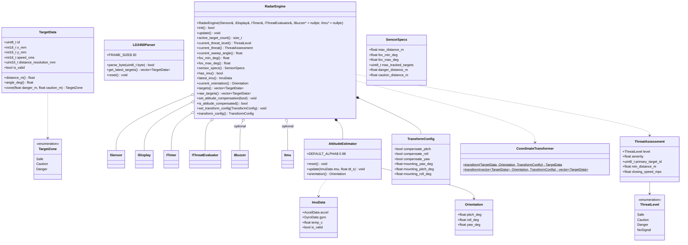

# Class Hierarchy & Interfaces

Source: `src/ports/`, `src/core/`, `src/adapters/`, `test_native/mocks/`. Public API only.

## Ports + implementations

```mermaid
classDiagram
    class ISensor {
        <<interface>>
        +init() bool
        +scan() vector~TargetData~
        +specs() SensorSpecs
        +is_connected() bool
    }

    class IDisplay {
        <<interface>>
        +init() bool
        +clear() void
        +draw_sweep(float angle_deg) void
        +draw_radar(vector~TargetData~ targets) void
        +draw_alert(ThreatAssessment threat) void
        +draw_attitude(Orientation orientation, ImuData* imu) void
        +flush() void
    }

    class ITimer {
        <<interface>>
        +millis() uint32_t
        +delay_ms(uint32_t ms) void
    }

    class IBuzzer {
        <<interface>>
        +beep(uint16_t freq_hz, uint16_t duration_ms) void
        +stop() void
    }

    class IImu {
        <<interface>>
        +init() bool
        +is_connected() bool
        +read_imu(ImuData& out) bool
    }

    class IThreatEvaluator {
        <<interface>>
        +evaluate(vector~TargetData~ targets) ThreatAssessment
    }

    class LD2450Adapter {
        +SPECS$ SensorSpecs
        +DEFAULT_BAUD_RATE$ 256000
        -LD2450Parser parser_
    }

    class ITelemetryDisplay {
        <<abstract>>
        #send_line(string line) void*
    }
    class SerialDisplayAdapter
    class WifiDisplayAdapter
    class ST7789Adapter {
        -TFT_eSPI tft_
    }

    class ESP32TimerAdapter
    class ESP32BuzzerAdapter
    class MPU6050Adapter {
        -TwoWire& wire_
    }
    class DistanceThreatEvaluator {
        +DistanceThreatEvaluator(float danger_dist_m, float caution_dist_m, float max_dist_m)
    }

    ISensor <|.. LD2450Adapter
    ISensor <|.. MockSensor
    IDisplay <|.. ITelemetryDisplay
    ITelemetryDisplay <|-- SerialDisplayAdapter
    ITelemetryDisplay <|-- WifiDisplayAdapter
    IDisplay <|.. ST7789Adapter
    IDisplay <|.. MockDisplay
    ITimer <|.. ESP32TimerAdapter
    ITimer <|.. MockTimer
    IBuzzer <|.. ESP32BuzzerAdapter
    IBuzzer <|.. MockBuzzer
    IImu <|.. MPU6050Adapter
    IImu <|.. MockImu
    IThreatEvaluator <|.. DistanceThreatEvaluator
    IThreatEvaluator <|.. MockThreatEvaluator
```

`ITelemetryDisplay` (`src/adapters/displays/`): buffers draw calls, `flush()` sends one `encode_telemetry_frame()` JSON line via `send_line()`. Serial → UART, WiFi → TCP client.

## Core

Free functions in core: `parse_mpu6050_burst()` (`mpu6050_parser.h`, used by `MPU6050Adapter`), `encode_telemetry_frame()` (`telemetry_frame.h`, used by `ITelemetryDisplay`).
