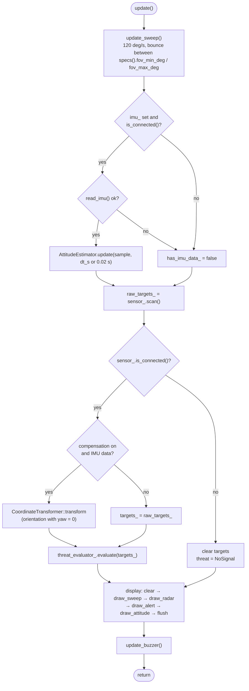
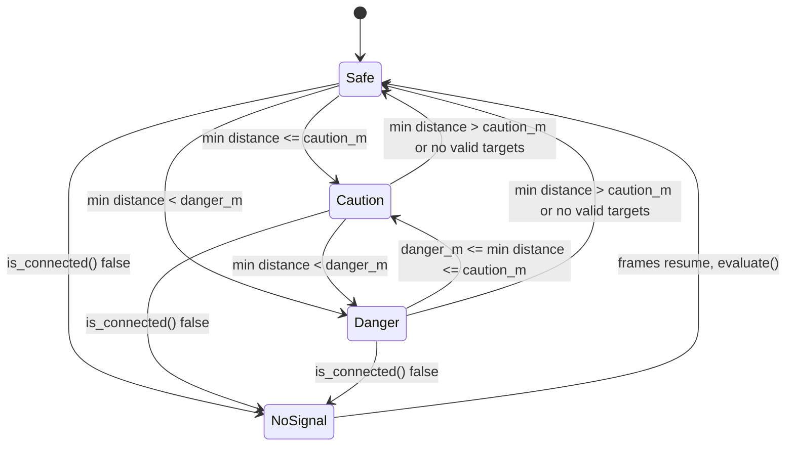

# Radar Engine Update Cycle & Threat Levels

Source: `src/core/radar_engine.cpp`, `src/core/distance_threat_evaluator.cpp`. No boot/idle state machine: engine runs `init()` once, then `update()` per loop tick.

## `update()` per tick

Yaw forced to 0: gyro-only yaw drifts, no compass. Only fixed `mounting_yaw_deg` applies.

## Threat level (re-evaluated every tick)

- No hysteresis: level is pure function of current closest valid target.
- `LD2450Adapter::SPECS`: danger 1.5 m, caution 3.5 m, max 6.0 m (override `RADAR_DANGER_DISTANCE_M`, `RADAR_CAUTION_DISTANCE_M`).
- `severity` = 1 − clamp(min_distance / max_distance_m, 0, 1).
- `NoSignal`: `LD2450Adapter` reports disconnected after `SIGNAL_TIMEOUT_MS` = 500 ms without frames.
- From `NoSignal`, the first tick with frames re-evaluates straight to whichever level applies.

## Buzzer pacing (`update_buzzer()`)

| Level | Interval | Tone |
|---|---|---|
| Danger | 250 ms | 2500 Hz, 50 ms |
| Caution | 1000 ms | 1500 Hz, 20 ms |
| Safe / NoSignal | none; next threat beeps immediately | — |
