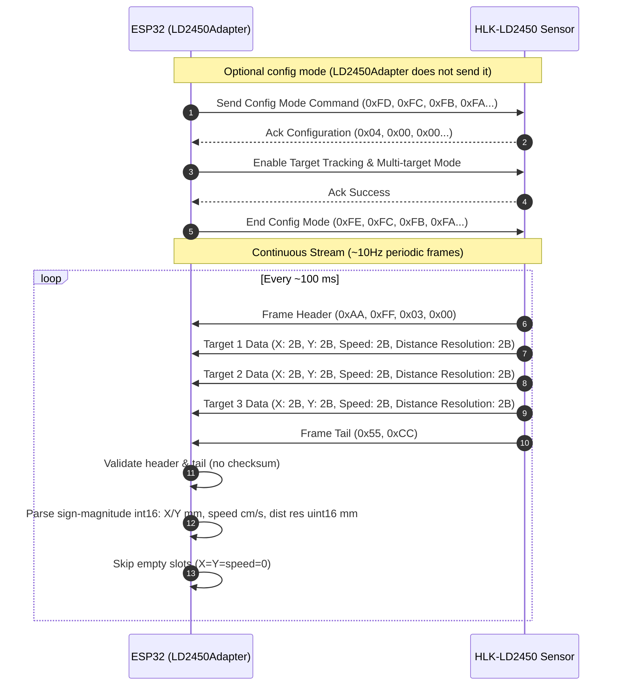

# HLK-LD2450 UART Protocol Sequence

HLK-LD2450: **256000 bps (8N1)**. Streams binary report frames by default: X, Y, speed, distance resolution for up to 3 targets.

---

## Frame Byte Layout

| Offset | Length | Field | Description |
|:------:|:------:|:-----:|:------------|
| 0 | 4 Bytes | Header | `0xAA 0xFF 0x03 0x00` |
| 4 | 8 Bytes | Target 1 | `X_L`, `X_H`, `Y_L`, `Y_H`, `Speed_L`, `Speed_H`, `Dist_Res_L`, `Dist_Res_H` |
| 12 | 8 Bytes | Target 2 | `X_L`, `X_H`, `Y_L`, `Y_H`, `Speed_L`, `Speed_H`, `Dist_Res_L`, `Dist_Res_H` |
| 20 | 8 Bytes | Target 3 | `X_L`, `X_H`, `Y_L`, `Y_H`, `Speed_L`, `Speed_H`, `Dist_Res_L`, `Dist_Res_H` |
| 28 | 2 Bytes | Tail | `0x55 0xCC` |

Total: **30 bytes**. Signed fields: sign-magnitude (bit 15 set = positive), little-endian.
