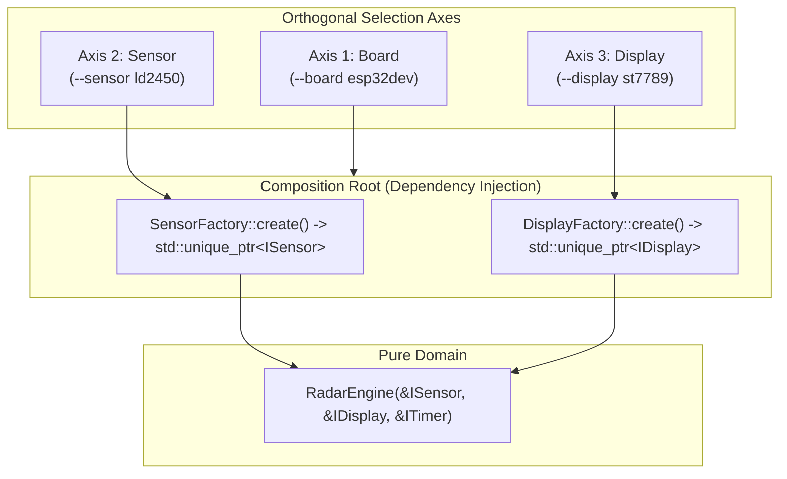

# Orthogonal Architecture Guide

## The Problem: Combinatorial Explosion

In typical embedded codebases, adding a new hardware module (microcontroller, sensor, or display) causes a multiplicative explosion of build targets:
$$\text{Environments} = N_{\text{boards}} \times M_{\text{sensors}} \times K_{\text{displays}}$$

If we support:
- **3 Boards:** ESP32 DevKit, ESP32-S3, Native Host
- **3 Sensors:** HLK-LD2450, Ai-Thinker RD-03D, RCWL-0516
- **3 Displays:** ST7789, ILI9341, SSD1306

A monolithic build matrix would require **27 hardcoded build targets** in `platformio.ini`! Adding just one more board would require adding 9 new configurations.

---

## The Solution: Decoupled Orthogonal Axes

By applying **Hexagonal Architecture (Ports & Adapters)**, each axis is completely independent:



### Adding New Components:
- **Adding a new board:** Implement 1 board definition in `platformio.ini` or pin mapping header.
- **Adding a new sensor:** Implement 1 class inheriting `ISensor`.
- **Adding a new display:** Implement 1 class inheriting `IDisplay`.

---

## Build Commands

You can freely select any combination of boards, single/multiple sensors, and single/multiple display sinks via `./scripts/build.sh`:

```bash
# Default build: ESP32 DevKit + LD2450 + ST7789
./scripts/build.sh

# Multi-display: Physical ST7789 TFT + PC Serial Telemetry over USB
./scripts/build.sh --displays st7789,serial

# Multi-sensor fusion: Dual LD2450s (front + rear)
./scripts/build.sh --sensors ld2450,rd03d --displays st7789,serial

# Dual TFT screens (e.g. main HUD + secondary target vector monitor):
./scripts/build.sh --displays st7789,ili9341

# Full custom permutation:
./scripts/build.sh --board esp32dev --sensors rcwl0516 --displays ssd1306,serial
```
