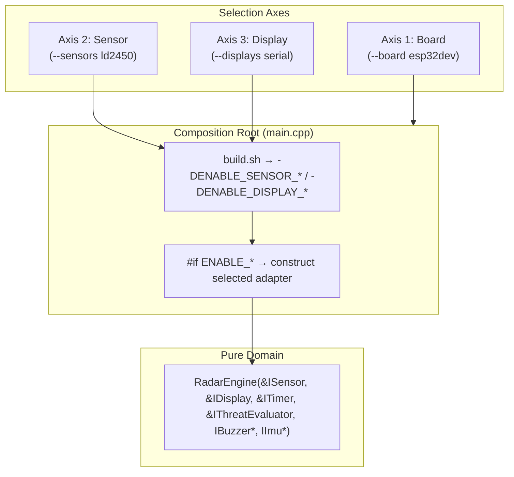

# Orthogonal Architecture Guide

## Problem: Combinatorial Explosion

Monolithic build matrix: every new board, sensor, or display multiplies build targets:
$$\text{Environments} = N_{\text{boards}} \times M_{\text{sensors}} \times K_{\text{displays}}$$

Example:
- **3 boards:** ESP32 DevKit, ESP32-S3, native host
- **3 sensors:** HLK-LD2450, Ai-Thinker RD-03D, RCWL-0516
- **3 displays:** ST7789, ILI9341, SSD1306

→ **27 hardcoded targets** in `platformio.ini`. One more board → +9 configs.

---

## Solution: Independent Axes

Ports & adapters → each axis independent:



### Adding Components
- **Board:** one `[env:<board>]` in `platformio.ini` with all wiring macros. No code change.
- **Sensor:** one class implementing `ISensor` + `main.cpp` block.
- **Display:** one class implementing `IDisplay` + `main.cpp` block.

---

## Build Commands

Implemented today: sensor `ld2450`; displays `serial` (default), `st7789` (stub), `wifi`; IMU `none` | `mpu6050`. One sensor, one display per build.

```bash
# Default build: esp32dev + LD2450 + serial telemetry
./scripts/build.sh

# TFT display
./scripts/build.sh --displays st7789

# WiFi TCP telemetry (creds from env)
WIFI_SSID=… WIFI_PASSWORD=… ./scripts/build.sh --displays wifi
```

Planned (rejected by `build.sh` until `CompositeSensor` / `CompositeDisplay` and adapters exist):

```bash
# Multi-display: Physical ST7789 TFT + PC Serial Telemetry over USB
./scripts/build.sh --displays st7789,serial

# Multi-sensor fusion: LD2450 (front) + RD-03D (rear)
./scripts/build.sh --sensors ld2450,rd03d --displays st7789,serial

# Dual TFT screens
./scripts/build.sh --displays st7789,ili9341

# Full custom permutation:
./scripts/build.sh --board esp32dev --sensors rcwl0516 --displays ssd1306,serial
```
