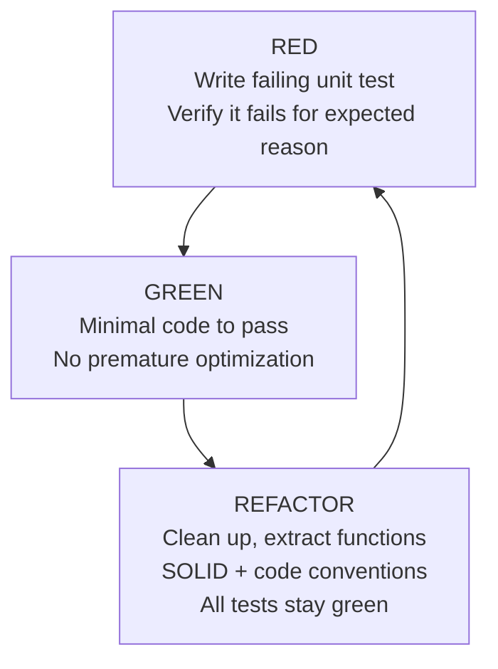

# Testing Guide & TDD Workflow

## TDD

**Red $\to$ Green $\to$ Refactor** for all core features.



1. **RED:** no production domain code without failing test first.
2. **GREEN:** simplest impl that passes.
3. **REFACTOR:** improve design, remove duplication; Yoda style, const-correctness, memory safety.

---

## Test Pyramid

1. **Native unit tests (Catch2 v3, host)**
   - `test_native/`
   - Covers `RadarEngine`, `DistanceThreatEvaluator`, `LD2450Parser`, `CoordinateTransformer`, `AttitudeEstimator`, telemetry framing.
   - Docker, milliseconds:
     ```bash
     ./scripts/test-native.sh
     ```
   - Core has no hardware deps → deterministic, mockable.

2. **Embedded tests (target)**
   - `test/test_embedded/` — empty placeholder; no on-device suite yet.
   - Intended scope: peripheral init, SPI bus, UART buffers on ESP32 or Wokwi.

3. **Python tool tests**
   - `scripts/tools/*/tests/`
   - `./scripts/test-python.sh`

---

## Writing Catch2 Tests

BDD structure (`SCENARIO`, `GIVEN`, `WHEN`, `THEN`). From `test_native/core/test_radar_engine.cpp`:

```cpp
SCENARIO("RadarEngine update loop and threat delegation", "[radar_engine][core]")
{
    GIVEN("An initialized RadarEngine with mock evaluator")
    {
        MockSensor sensor;
        MockDisplay display;
        MockTimer timer;
        MockThreatEvaluator evaluator;
        MockBuzzer buzzer;

        RadarEngine engine(sensor, display, timer, evaluator, &buzzer);
        engine.init();

        WHEN("No targets are detected and evaluator returns Safe")
        {
            sensor.set_targets({});
            evaluator.set_assessment({ThreatLevel::Safe, 0.0f, 0, 0.0f, 0.0f});

            engine.update();

            THEN("Display renders with Safe alert level")
            {
                REQUIRE(1 == sensor.scan_call_count());
                REQUIRE(1 == evaluator.evaluate_call_count());
                REQUIRE(1 == display.draw_radar_call_count());
                REQUIRE(ThreatLevel::Safe == display.last_threat().level);
                REQUIRE(0 == buzzer.beep_call_count());
            }
        }
    }
}
```

---

## Yoda Comparisons in Assertions

Constant on left:

```cpp
// Correct
REQUIRE(1 == engine.active_target_count());
REQUIRE(true == ok);

// Incorrect
REQUIRE(engine.active_target_count() == 1);
```

---

## CI

`.github/workflows/ci.yml` runs on push and PR to `main`: format check, static analysis, native tests. Failing tests block merge.
