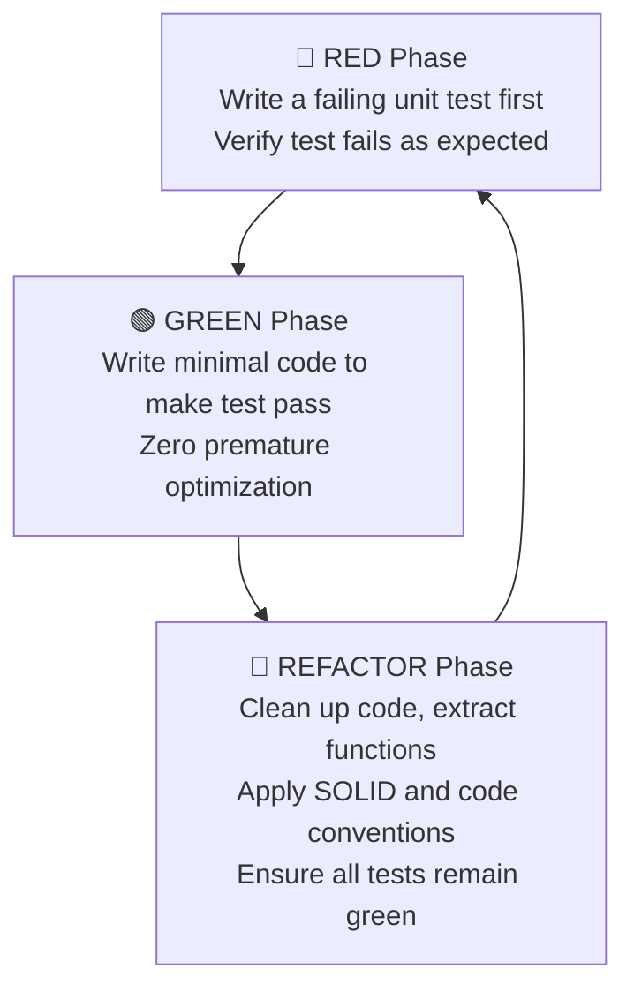

# Testing Guide & TDD Workflow

## Philosophy: Test-Driven Development (TDD)

We strictly follow the **Red $\to$ Green $\to$ Refactor** cycle for all core application features.



1. **🔴 RED:** Never write production domain code without a failing unit test verifying the requirement.
2. **🟢 GREEN:** Write the simplest possible implementation that satisfies the test.
3. **🔵 REFACTOR:** Improve design, remove duplication, and ensure adherence to Yoda style, const-correctness, and memory safety.

---

## Test Pyramid

1. **Native Unit Tests (Catch2 v3, Host-side)**
   - Located in `test_native/`
   - Test `RadarEngine`, `SignalProcessor`, protocol framing, and mathematical utilities.
   - Run inside Docker container in milliseconds:
     ```bash
     ./scripts/test-native.sh
     ```
   - Core domain contains no hardware dependencies, making tests 100% deterministic and mock-friendly.

2. **Integration / Embedded Tests (PlatformIO Unity, Target-side)**
   - Located in `test/test_embedded/`
   - Test real peripheral interaction, SPI bus initialization, and UART communication buffers on physical ESP32 hardware or Wokwi simulator.

---

## Writing Catch2 Tests

Tests should follow BDD structure (`SCENARIO`, `GIVEN`, `WHEN`, `THEN`):

```cpp
#include <catch2/catch_test_macros.hpp>
#include "core/radar_engine.h"
#include "mocks/mock_sensor.h"
#include "mocks/mock_display.h"
#include "mocks/mock_timer.h"

SCENARIO("Radar engine tracks newly detected target", "[core][radar]")
{
    GIVEN("An initialized radar engine with mock peripherals")
    {
        MockSensor mock_sensor;
        MockDisplay mock_display;
        MockTimer mock_timer;
        RadarEngine engine(mock_sensor, mock_display, mock_timer);

        WHEN("Sensor detects a target at 2.5 meters in front")
        {
            mock_sensor.set_simulated_targets({
                TargetData{ .x = 0.0f, .y = 2.5f, .speed = 0.1f, .distance = 2.5f }
            });

            engine.update();

            THEN("The engine registers exactly 1 active contact in the mid zone")
            {
                REQUIRE(1 == engine.active_target_count());
                REQUIRE(TargetZone::Mid == engine.get_target(0).zone);
            }
        }
    }
}
```

---

## Yoda Conditions in Assertions

In accordance with our project rules, always use **Yoda style** comparisons:

```cpp
// Correct
REQUIRE(1 == engine.active_target_count());
REQUIRE(true == engine.is_scanning());

// Incorrect
REQUIRE(engine.active_target_count() == 1);
```

---

## Continuous Integration Verification

Catch2 native tests run on every push and pull request via `.github/workflows/ci.yml`. Pull requests with failing tests are blocked from merging.
